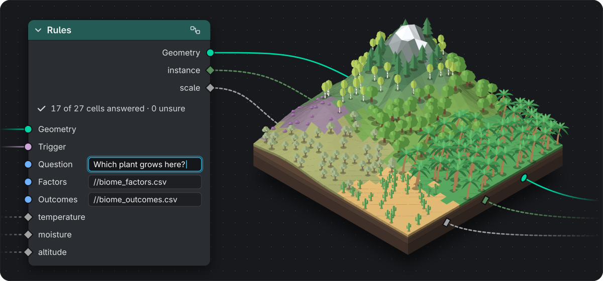
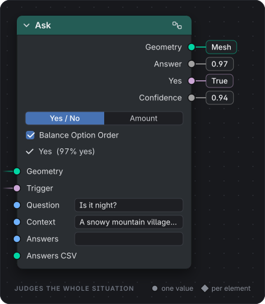
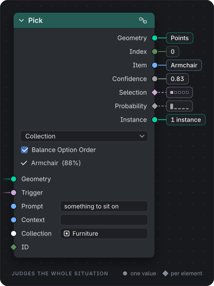
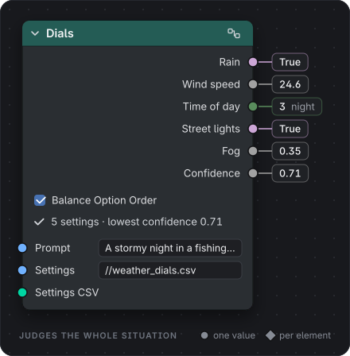
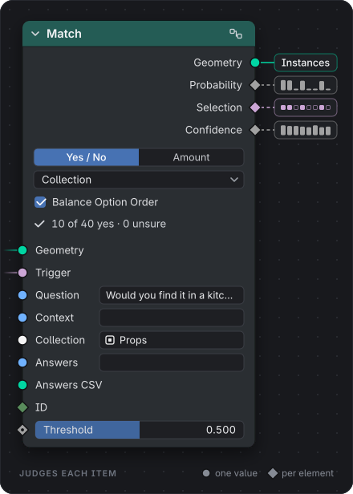
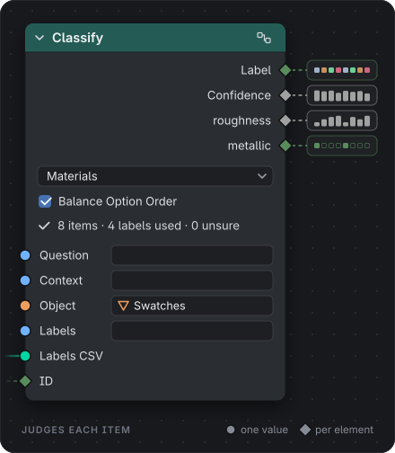
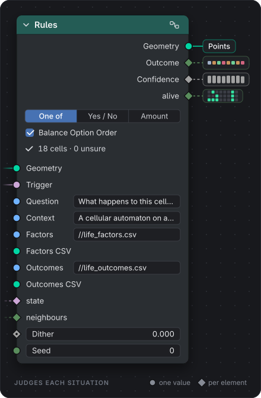
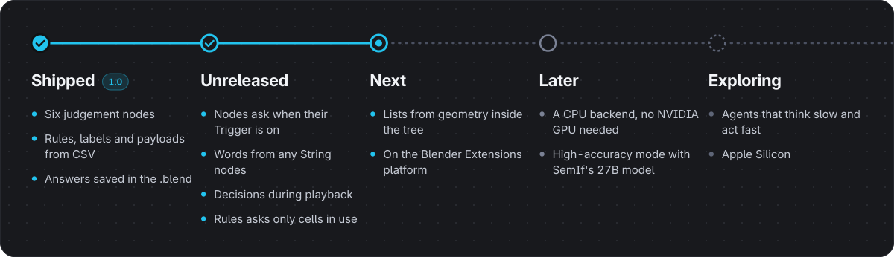

<h1 align="center">OpenAct</h1>

<h3 align="center">Judgement nodes for Blender Geometry Nodes</h3>

One forward pass. No text. Just decisions.

  

  <b>Six Geometry Nodes that make judgements:</b> Ask, Pick, Dials, Match, Classify and Rules. 
  Words go in: a question, a prompt, a list or a table of rules. Decisions come out: 
  numbers, selections, picks and labels, per element when you need them. 
  A local model scores every allowed answer in one forward pass. It never writes text.

  
  
  
  
  

  <a href="#quick-start">Quick start</a> ·
  <a href="#the-six-nodes">The nodes</a> ·
  <a href="#how-it-works">How it works</a> ·
  <a href="docs/GUIDE.md">User guide</a> ·
  <a href="#roadmap">Roadmap</a> ·
  <a href="CONTRIBUTING.md">Contributing</a>

 

## Why OpenAct

- **Fast.** A chat model answers by writing text, one token at a time. OpenAct never writes: it scores every allowed
  answer in a single forward pass, and batches many questions into one request. On an RTX 3090, a new answer shows up
  in 0.2 to 0.6 seconds, and 216 yes/no cells fill in under 9 seconds. Reading the answers back costs about a
  millisecond per million elements.
- **Decisions, not text.** Every result is a number, a switch, an index or a label, ready to wire into your tree,
  with nothing to parse.
- **Runs on your GPU.** Qwen3.5-4B runs on your own NVIDIA card. After the one-time install, OpenAct talks only to
  `127.0.0.1`: nothing leaves your computer.
- **Asks only when words change.** Never during evaluation, playback or rendering. Answers arrive in the background,
  and only the rows whose words changed are asked again.
- **Saved in the .blend.** Answers live in the file, so it opens, plays and renders without the model, and even
  without the add-on. Render farms need nothing extra.
- **Written in CSV.** Keep rules, labels and settings in CSV files next to the .blend. Numbers beside labels and
  outcomes become output sockets, and saved edits show up while Blender runs.
- **You have the last word.** Every answer comes with a confidence, and unsure ones are flagged. Lock any answer in an
  Overrides CSV, and it is never asked again.

## Quick start

**You need** Blender 4.5 or newer, Windows 10 or 11, an NVIDIA GPU with 10 GB of VRAM, and 15 GB of free disk space
for the one-time model install. Linux is best effort. Opening, playing and rendering saved files needs none of
this, not even the add-on.

1. **Download** `openact-1.0.0.zip` from the [latest release](https://github.com/nicolaiprodromov/openact/releases/latest),
   or [build it from source](CONTRIBUTING.md#set-up-a-checkout).
2. **Install** it in Blender: *Edit › Preferences › Get Extensions › Install from Disk…*
3. **Get the model.** In a Geometry Node editor, press <kbd>N</kbd>, open the **OpenAct** tab and click
   **Install Model**. It downloads about 12 GB once, pinned and hash-checked.
4. **Add a node** with <kbd>Shift</kbd> <kbd>A</kbd> › **OpenAct** and type a question. The model loads on first
   use, in 12 to 40 seconds; after that, a new answer takes well under a second.

## The six nodes

**Ask**, **Pick** and **Dials** judge the whole situation. **Match** and **Classify** judge each item of a list.
**Rules** judges each measured situation. Add them with <kbd>Shift</kbd> <kbd>A</kbd> › **OpenAct**. On the cards,
a round socket carries one value and a diamond carries a value per element; the chips show what the example words
produce.

<table>
  <tr>
    <td width="440"></td>
    <td valign="middle">
      <h3>Ask</h3>
      
One question about the whole scene, answered <b>yes / no</b> or as an <b>amount</b> from 0 to 1.
      Use it to switch a branch, light a window or set a strength.

      
EXAMPLE <i>"Is it night?"</i> → <b>Answer</b> 0.97, <b>Yes</b> on.

    </td>
  </tr>
  <tr>
    <td width="440"></td>
    <td valign="middle">
      <h3>Pick</h3>
      
Chooses the one entry of a list that best fits a prompt. The list is typed, read from a CSV, or taken
      from a collection, an object's materials or its attribute names.

      
EXAMPLE <i>"something to sit on"</i> from a Furniture collection → the <b>Armchair</b>, as an
      instance.

    </td>
  </tr>
  <tr>
    <td width="440"></td>
    <td valign="middle">
      <h3>Dials</h3>
      
One prompt sets many named settings at once: switches, amounts in any range, or one of several options.
      Each setting becomes its own output, and all of them are answered in one request.

      
EXAMPLE <i>"A stormy night in a fishing village"</i> → rain on, wind 24.6, night, street
      lights on.

    </td>
  </tr>
  <tr>
    <td width="440"></td>
    <td valign="middle">
      <h3>Match</h3>
      
Asks the same question about every item of a list. Each element reads its item's probability, and
      <b>Selection</b> marks the items at or above the threshold.

      
EXAMPLE <i>"Would you find it in a kitchen?"</i> over 40 props → the pans and kettles stay,
      the sofa goes.

    </td>
  </tr>
  <tr>
    <td width="440"></td>
    <td valign="middle">
      <h3>Classify</h3>
      
Gives every item one of several labels. The numeric columns of the Labels CSV, like roughness or metallic,
      come out as outputs at the chosen label.

      
EXAMPLE Each material slot → <b>metal</b>, <b>wood</b>, <b>stone</b> or <b>fabric</b>, with
      its roughness and metallic.

    </td>
  </tr>
  <tr>
    <td width="440"></td>
    <td valign="middle">
      <h3>Rules</h3>
      
Decides a table of situations. Factors such as amount bands, categories and flags span a grid of cells.
      The model decides each cell once, and every element reads its own cell through the factor inputs.

      
EXAMPLE Conway's Game of Life, written as four outcomes, each with a sentence that says when
      it happens.

    </td>
  </tr>
</table>

The [user guide](docs/GUIDE.md#the-six-nodes) covers every input, output and option.

## How it works

1. **You write words.** Type them on the node, expose them on the modifier panel, or keep them in CSV files.
2. **OpenAct asks outside evaluation.** When words change, it sends only the new questions to its model server on
   `127.0.0.1`. There, [SemIf](https://github.com/TheoLeeCJ/SemIf-OpenJev) scores each allowed answer with
   [Qwen3.5-4B](https://huggingface.co/Qwen/Qwen3.5-4B) in a single forward pass. No text is generated.
3. **The answers become a table inside the node.** Geometry Nodes looks them up per element, through an ID or the
   Rules factor inputs, as fast as any other lookup.
4. **The table is saved with the file.** Anyone can open, play and render it on Blender 4.5 or newer, with or
   without OpenAct.

## Demos

Six scenes ship in [`demos/`](demos), answered and saved. Open one and press play: they need neither the model nor
the add-on. With OpenAct installed, the sidebar shows their tables, and editing their prompts or CSVs asks the model
again.

| Scene | What it shows |
|:---|:---|
| `life.blend` | Conway's Game of Life from a CSV, with four rule sets to switch between (Rules) |
| `biome.blend` | Plants chosen from habitat descriptions, and snow laid by altitude (Rules) |
| `kitchen.blend` | 40 props kept or dropped for a kitchen, scaled by weight and placed by room (Match, Classify) |
| `materials.blend` | Material slots sorted into families, with each family's roughness and metallic (Classify, Match) |
| `weather.blend` | One prompt sets rain, wind, time of day, street lights and fog (Dials) |
| `ask_pick.blend` | "Is it night?" and a furniture pick, with a different prompt on each object (Ask, Pick) |

## Documentation

- **[User guide](docs/GUIDE.md):** install and the model runtime, the nodes in depth, CSV formats, overrides,
  templates, render farms, and known issues.
- **[Changelog](CHANGELOG.md):** what changed in each release.
- **[Contributing](CONTRIBUTING.md):** tests, demos, code guidelines and releases.
- **[Design](docs/DESIGN.md):** the v1 design, with the reasons behind every decision.
- **[Branding](branding/README.md):** the logo, colours and type.

## Roadmap

  

Ideas and requests are welcome: [open an issue](https://github.com/nicolaiprodromov/openact/issues).

## Credits and licence

OpenAct is free software, licensed under [GPL-3.0-or-later](LICENSE), which the extension zip carries too. It
builds on:

- **[SemIf](https://github.com/TheoLeeCJ/SemIf-OpenJev)** (formerly OpenJev) by TheoLeeCJ, MIT: the one-pass decision
  method. The installer installs it into the runtime; it is not bundled.
- **[Qwen3.5-4B](https://huggingface.co/Qwen/Qwen3.5-4B)** by the Qwen team (Alibaba), Apache-2.0: the model. The
  installer downloads it from Hugging Face; it is not redistributed.
- **PyTorch** (BSD-3-Clause), **Hugging Face Transformers** and **huggingface_hub** (Apache-2.0) and **uv** (MIT or
  Apache-2.0), installed into the runtime.
- **[Inter](https://rsms.me/inter/)** (SIL Open Font License 1.1), the typeface of Blender's interface, set in the
  artwork.

Not affiliated with TypeSafe or Jev, its hosted model. The model server is Jev-compatible only in the shape of its
requests (`POST /v1/systemone`).

## Disclaimer

OpenAct is partly vibe-coded with AI. I review all of the code by hand and test it thoroughly, including with the
headless test suites that run on Blender 4.5, 5.0 and 5.1.

 

  <picture>
    <source media="(prefers-color-scheme: dark)" srcset="branding/openact-logo-dark.svg">
    
  </picture>

