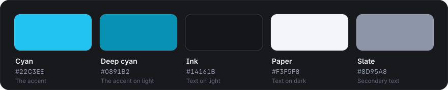

# OpenAct branding

  <picture>
    <source media="(prefers-color-scheme: dark)" srcset="openact-logo-dark.svg">
    
  </picture>

The logo is part of OpenAct and, like everything in this repository, it is free software under the project's
[licence](../LICENSE). Every file here is generated by [`tools/build_art.py`](../tools/build_art.py): change the
script, not the SVGs.

## The logo

The logo is the word itself, with no symbol: **Open** in the foreground colour and **Act** in cyan, the part that
decides.

## Files

| File | Use it for |
|---|---|
| [`openact-logo-dark.svg`](openact-logo-dark.svg) | Dark backgrounds: "Open" in white |
| [`openact-logo-light.svg`](openact-logo-light.svg) | Light backgrounds: "Open" in ink, "Act" in deep cyan |

On GitHub, a `<picture>` element picks the right one for the reader's theme, as this page and the README do.

## Colours

The brand is flat: one accent colour, and no gradients.

| Name | Hex | Role |
|---|---|---|
| Cyan | `#22C3EE` | The accent: "Act", the chosen answer, what is done or next |
| Deep cyan | `#0891B2` | The accent on light backgrounds, where cyan is too pale to read |
| Ink | `#14161B` | Text on light backgrounds |
| Paper | `#F3F5F8` | Text on dark backgrounds |
| Slate | `#8D95A8` | Secondary text on dark backgrounds |

The node cards use Blender's own socket colours, so they read like the node editor.

## Type

Everything is set in [Inter](https://rsms.me/inter/) (SIL Open Font License 1.1), the typeface of Blender's own
interface. The wordmark is Inter Bold with slightly tight letter spacing (−1.2 %). All text in the artwork is
converted to outlines, so no font is needed to show it.

## Using the logo

- Leave clear space around the logo of at least the height of its capital O.
- Keep its colours: "Open" in the foreground colour, "Act" in cyan. Where colour isn't possible, use a single colour.
- Don't stretch, rotate or re-letter it, and don't put it on a busy background.
- Use it to refer to OpenAct, not in a way that suggests your own project is OpenAct or endorsed by it.
